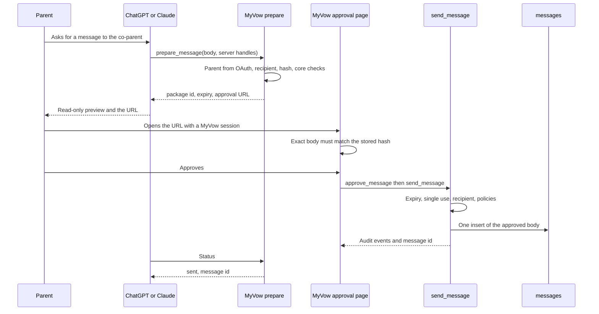

# External AI message approval

Provider-independent design for a parent-approved outbound message that starts in ChatGPT or Claude. No application code is changed by this document.

This service sends only after MyVow has recorded a parent approval of one exact package. Sage's declarative register, fidelity wording, and co-parent phrasing stay optional. The record rules do not.

Related: [Sage rule and parameter inventory](sage-rule-inventory.md).

## Decision

`prepare_message` is the only operation a model may call.

`approve_message` and `send_message` run inside MyVow, on a page where the parent is signed in to MyVow. They are not MCP tools. A model argument, a chat message that says "Confirmed.", or a host Allow button is not approval.

Both ChatGPT and Claude can show a draft in the conversation. As of the provider documents reviewed for this proposal, neither one provides a MyVow-verified per-message approval inside that conversation. The secure path is a MyVow-hosted approval page. An in-chat card may show the draft and the link. It does not approve.

## Roles

| Operation | Who may invoke it | What it does |
| --- | --- | --- |
| `prepare_message` | The model, over MCP, with the parent's OAuth token | Builds one immutable pending package. Does not send. |
| `approve_message` | The signed-in parent, on a MyVow page | Binds that parent's MyVow session to the package hash. Mints a single-use authorization the model never receives. |
| `send_message` | The approval page, in the same server request as a successful approval | Re-checks the package, then inserts one message through the existing send path. |

The model learns a package id, an expiration, and a status. It does not learn an approval token, the recipient email, or a capability that sends.

## Package

A pending-send package is immutable. A change of body, recipient, conversation, or attachments does not edit it. MyVow creates a new package and marks the old one `superseded`.

| Field | Set by | Rule |
| --- | --- | --- |
| `package_id` | Server | New id. The model may pass this id back to read status. It cannot choose it. |
| `parent_user_id` | OAuth token on prepare, checked again against the MyVow session on approve | The model cannot name the parent. |
| `case_id` | Membership of that parent | The model cannot name the case. |
| Recipient | `resolveCaseRecipient` | Must be another parent on the case. The sender cannot be the recipient. A missing address is not guessed. |
| `conversation_id` | A server-minted handle, or empty | Empty means create a conversation at send time. Subject is a label, not a match key. An id that is not on the case is rejected. |
| Body | The text that will be stored | Exact bytes the parent will see. |
| Attachments | Server-minted file handles | Each handle is checked with the existing attachment preflight. |
| `content_hash` | Server | SHA-256 over a canonical encoding of recipient, conversation id, body, and ordered attachment ids. This is the approval hash. It is not `messages.content_hash`. |
| `review_status` | Server | `sage_reviewed`, `unreviewed`, or `parent_edited`. The model cannot set it. |
| `expires_at` | Server | Proposed lifetime: 15 minutes from prepare. A Sage review receipt lives for one hour. That TTL is not reused here. |
| Status | Server | `pending`, `approved`, `sent`, `superseded`, `expired`, or `rejected`. |

`prepare_message` also runs the core content checks before it stores a package: insult-only refusal (`isInsultOnly`), unsupported legal-obligation rewrite or refusal (`unsupportedObligations`), and attachment preflight. A package that fails those checks is not created.

The declarative register (`applyMessageRegister`) is not applied on this path. Rewriting the body after the parent has been shown it would approve different words from the ones they read. A Sage-drafted body may already have that register. An external body is sent as approved.

## Review status

| Status | When the server sets it | Effect on send |
| --- | --- | --- |
| `unreviewed` | The body came from an external model and Sage did not review that exact text. | Send is allowed after the parent approves that text on the MyVow page. |
| `sage_reviewed` | A Sage review receipt from `issueReviewReceipt` covers the exact body for this parent, and it has not expired. | Metadata only. The parent still approves on the MyVow page. |
| `parent_edited` | The parent changes the body on the approval page. | The edited text is a new package. The previous package is `superseded`. The parent approves the new hash. Sage is not asked to review the edit unless the parent asks. |

This splits the current `reviewGate` escape. Today's gate can send on `edit_unreviewed_ack` or `review_unavailable_ack` from the client that is posting the send. Those flags are not accepted from a model. Parent approval of the exact hash replaces them for this path.

Sage fidelity remains optional. If the parent asks Sage to review, the existing reviewer runs, missed reasons stay in the server log, and the parent still sees the fixed refusal sentence when the review fails. A failed review does not create a package.

## Approval and send

The approval page loads the package only when the MyVow session user is `parent_user_id`. It shows the exact body, the recipient as "your co-parent" plus the address the server resolved (so the parent can see where it will go), the conversation title if one is already chosen, the attachment names, the review status, and the expiration.

Approve does all of the following in one transaction:

1. Reloads the package. Status must be `pending`. `expires_at` must be in the future. The hash of the stored fields must equal `content_hash`.
2. Rejects the request if any displayed field differs from the stored field.
3. Marks the package `approved`, stores the approval time and the MyVow session id, and consumes a single-use authorization row bound to `package_id` and `content_hash`.
4. Calls `send_message` before returning.

`send_message` checks, in order:

1. Authorization row exists, is unused, and matches the hash and the parent.
2. Package is `approved` and unexpired.
3. Recipient still passes `resolveCaseRecipient`.
4. Conversation id, when present, is still on the case.
5. Attachments still pass preflight.
6. `sendingPaused` for this sender. Cool-off is an existing send block. The inventory left it undecided for external tools. This design honors it until the product owner says external sends skip it.
7. Claim the send. A second caller finds the claim or the sent message and does not insert again.

The insert goes through `deliverParentMessage` with the approved body. `sage_proposal_id` on the message is the package id, so the partial unique index in `20261105190000_messages_sage_proposal_unique.sql` is the duplicate-send guard once that migration is applied. Until it is applied, the application claim is the only guard, which is the same gap the inventory records for Sage.

A retry after a crash, with the same package id, returns the existing message. It does not insert a second row. It should not send a second co-parent notice. Today's replay path can re-announce. The implementation has to stop that for this service.

## Audit receipt

Two insert-only rows, not one mutable receipt. Message content cannot be updated, so the audit should not need an update either.

| Event | Written when | Fields |
| --- | --- | --- |
| Approval | Parent approval commits | `package_id`, `content_hash`, `parent_user_id`, approval time, review status |
| Delivery | Insert finishes or fails | `package_id`, `message_id` when one exists, result (`saved`, `email_accepted`, or `failed`), time |

The communication record does not read these rows. It reads `messages`, as it does today. Review status is not evidence and does not appear in the record export. The record shows the parent as the sender and the approved body as `original_content`.

`messages.content_hash` remains the trigger hash of `original_content` (`hash_message_content`). The package hash covers recipient, conversation, and attachments as well. Reports must not treat them as the same value.

## Idempotency and invalidation

| Event | Result |
| --- | --- |
| Same package sent twice | Second call returns the first message id. Unique index on `sage_proposal_id` when applied. |
| Parent or model changes the body, recipient, conversation, or attachments | Old package becomes `superseded`. Its authorization, if any, no longer matches. A new package needs a new approval. |
| Package expires | Status `expired`. Prepare again. |
| Message already stored for this package | `messageSendDecision` returns `already_sent`. HTTP 409 on a second agree, matching the Sage inbox path. |
| Undo | Not offered. Undo on a Sage card clears approval flags and does not unsend. A sent external package has no undo. |

A sent package is frozen by the message triggers: no delete, no change to `original_content`, no later change to `ai_rewritten_content` once set.

## Sage proposal lifecycle

External packages use the same lifecycle as a `reply_coparent` proposal. They do not add a second send implementation.

| Today | External package |
| --- | --- |
| Proposal id, `requires_approval`, not executed | Package id stored as that proposal. `requires_approval` stays true until the MyVow page approves. |
| `reviseProposal` freezes the old object as `superseded` and inserts a replacement | A changed package is that revision. The replacement is not approved. |
| Card Send is the parent's press | The approval page is the press. |
| `finalizeExecutedProposal` after a successful insert | Same call, after `deliverParentMessage` returns a message id. |
| Superseded execution is rejected | Same `supersededExecutionError`. |

The model never receives a tool that sets `executed`, `approved`, or `result_message_id`.

Conversation identity is unchanged. `chooseSharedConversation` takes the explicit conversation id, then `email_thread_id`, and otherwise creates. Subject is only the label.

Child assignment on create stays `proposedChildIds`: a whole-word first name, or none. The tag is still not written into the communication record.

## What the model is allowed to read

Unchanged from the inventory's proof-of-concept scope. `prepare_message` does not widen it. The model may pass a draft body and handles MyVow minted for this parent. It may not read the other parent's Sage journal, child-entered chats, co-parent message history, file bytes, or court-order files in order to draft.

## Provider capabilities

Reviewed against OpenAI's ChatGPT plugin reference and UI guide, Anthropic's connector authentication and MCP Apps quickstart, the Claude Help Center pages on custom connectors and interactive connectors, and the MCP Apps overview. Dates of those pages were current as of this writing. Behavior inside a specific chat account was not exercised.

### Verified

| Capability | ChatGPT | Claude |
| --- | --- | --- |
| Per-user OAuth to MyVow when the connector is added | Documented for ChatGPT apps. | Documented. Claude supports OAuth with dynamic client registration, client ID metadata, or Anthropic-held client credentials. A machine-to-machine client-credentials grant is not supported. Users still pass MyVow's consent screen. |
| Model calls MyVow tools with that token | Documented MCP tool calls. | Documented. Claude shows an Allow prompt. "Allow always" skips later prompts for a trusted tool. The Help Center tells users to use that only when the tool may run unsupervised. |
| Inline UI in a sandboxed iframe | Documented MCP Apps / ChatGPT widget. The iframe cannot read the host page's cookies. | Documented MCP Apps. Same sandbox statement in the MCP Apps overview: the iframe cannot read the host's cookies or storage. |
| Host-rendered confirmation of a tool call | Documented for approval-gated tools. Arguments are delivered to the widget after the user approves. `destructiveHint` asks the host to elicit approval. | Documented Allow / Allow always for connector tools. The published confirm-widget sample posts the text "Confirmed." back into the chat. |
| Open a MyVow URL outside the chat | Documented `openExternal`, limited to allowlisted `redirect_domains`. | Interactive connectors can confirm inside the iframe. A guaranteed external handoff equivalent to `openExternal` was not the documented approval mechanism. A normal link in the tool result is the portable option. |
| Hide a tool from the model and expose it only to the UI | Documented `_meta.ui.visibility` values `model` and `app`. | The shared MCP Apps spec says the host controls which tools the iframe may call. Claude's docs reviewed here do not state that a tool hidden from the model cannot be invoked by the model. |

### Assumptions

These are not documented guarantees, and this design does not depend on them.

| Assumption | Why it is not used |
| --- | --- |
| The host Allow button is a MyVow authentication of this parent for this hash. | Allow authorizes a tool call the model assembled. OAuth happened earlier, when the connector was connected. Allow always removes even that click. |
| The word "Confirmed." from a widget is approval. | The published Claude sample delivers that word to the model as a user message. The model can produce the same word without a click. |
| The iframe can see the parent's MyVow session cookie. | The sandbox blocks host cookies. A widget on a host origin is not the MyVow origin. |
| Embedding the MyVow approval page inside the chat iframe is available without review. | ChatGPT documents `frameDomains` for subframes of the plugin's own domain, with a justification and possible extra review. That is not a default, and it was not confirmed as granted for MyVow. |
| Claude Code shows the same card. | Anthropic's MCP Apps quickstart says Claude Code calls the tool as text and does not render the UI. |

### Fallback

Use the hosted page for both providers.

1. The model calls `prepare_message`.
2. MyVow returns a package id and an `https://` approval URL on the MyVow origin.
3. The chat may render a read-only card: body, expiration, review status, and the link.
4. The parent opens the link, signs in if needed, and approves.
5. MyVow sends. The model may poll status. Status is `sent` or `expired` or `superseded`, with the message id after send. The body is not returned again.

In-chat approval can be reconsidered only if a provider demonstrates all three of the following: the model cannot call the approve operation, the approval surface is a MyVow origin with the parent's own session, and the click is bound to the package hash on MyVow's server. None of the documents reviewed show that combination.

## Sequence

## Security

| Threat | Control |
| --- | --- |
| Model sets `approved: true` or names a parent | Those fields are not tool inputs. Parent id comes from the token, then from the MyVow session. |
| Model sends by calling a tool | `send_message` is not an MCP tool. |
| Host Allow, or Allow always, sends | Allow only lets `prepare_message` run. Prepare does not insert into `messages`. |
| Widget posts "Confirmed." | The approval page ignores chat text. It requires the session and the hash. |
| Body changes after approval | Hash mismatch supersedes the package. The authorization row does not match the new hash. |
| Replay of an approval | Authorization row is single-use. The message unique index rejects a second insert for the same package id. |
| Approval for a different parent | Page and send both require the session user to equal `parent_user_id`. |
| Cross-site approval | Approval is a MyVow POST with the session cookie and a CSRF token. The MCP token is not accepted as the approval credential. |
| Prompt injection inside the draft | The body is stored data. It is shown to the parent. It is not executed as a tool argument at send time. |
| Private strategy in the tool result | Prepare does not accept or return `private_objective` or fidelity `missed` lines. |
| Service role bypasses RLS | The MCP handler and the approval page check membership in application code. RLS is not the control, because the API uses the service role. Message triggers still block delete and content edits. |
| Stolen approval URL | The URL identifies the package. Opening it requires the parent's MyVow session. Approving requires that session to be the package's parent. A URL in the model transcript is not sufficient. |
| Expired package | Send re-checks `expires_at`. Prepare again. |

## Core safeguards and Sage methodology

Applied on every external send:

- Parent identity from MyVow, at approval time
- Exact content hash, invalidated on change
- Recipient is a parent on the case
- Attachment preflight
- Insult-only refusal
- Unsupported legal-obligation check
- One package, one message
- Message immutability triggers
- Conversation id, not subject, decides the thread
- Child tag is not evidence
- Fidelity failure reasons are not shown
- Nothing sends without the approval-page press

Not applied, because they are Sage methodology:

- Declarative register and the logistics rewrite
- Greeting and softener bans
- "Your co-parent" as a rewrite of the stored body
- Short topic titles, except the usual label rule if a new conversation is created
- The half-coverage question heuristic

Cool-off is called because it already blocks `deliverParentMessage`. Whether an external send should be able to skip it is still the open product decision in the inventory.

## Phased plan

### Phase 1. Approval service inside MyVow

Add the package, the authorization row, and the two audit events. The approval page approves and sends through `deliverParentMessage`. No ChatGPT or Claude connection.

Exit: a parent can approve one package once. A second send returns the same message. An edited body cannot use the old approval. A message cannot be deleted. The communication record shows the sent body and does not show review status.

### Phase 2. Prepare tool

Add MCP OAuth and `prepare_message` plus a status read. The tool returns the approval URL. There is no approve tool and no send tool.

Exit: a model that skips the URL cannot insert a message. A model that changes the body after approval is superseded.

### Phase 3. Read-only card

Add the MCP App resource for Claude and ChatGPT. The card shows the stored body and the URL. The card's buttons do not call send.

Exit: both hosts either render the card or, if a host does not, the URL in the tool result still works. Claude Code is expected not to render the card.

### Phase 4. In-chat approval, only after a proof

Revisit only with evidence that the model cannot invoke approval, the surface is the MyVow origin, and the click is bound to the hash. That evidence is not in the current provider documents.

## Product-owner choices still open

1. Confirm the hosted page as the approval for both providers, with the in-chat card limited to display.
2. Confirm that an `unreviewed` package may be sent when the parent has approved that exact text, and that Sage review stays optional.
3. Confirm whether cool-off blocks an external send. This design blocks it.
4. Confirm the 15-minute package lifetime.
5. Confirm that review status stays off the communication record.
